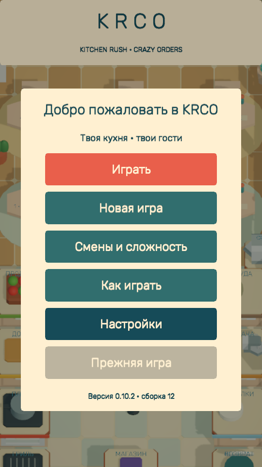
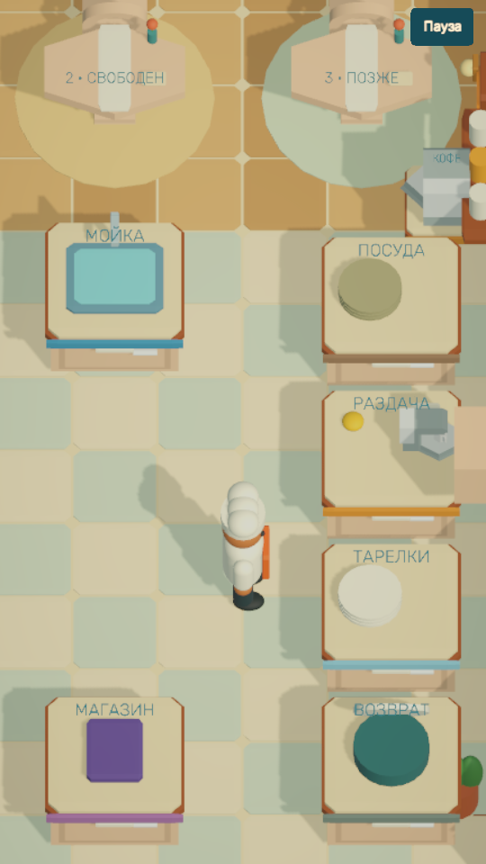
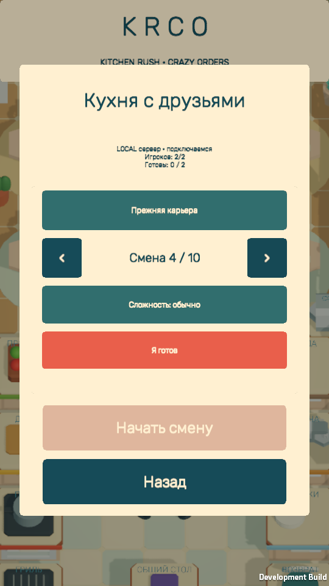
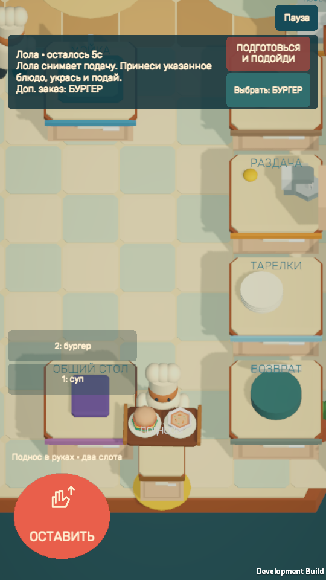
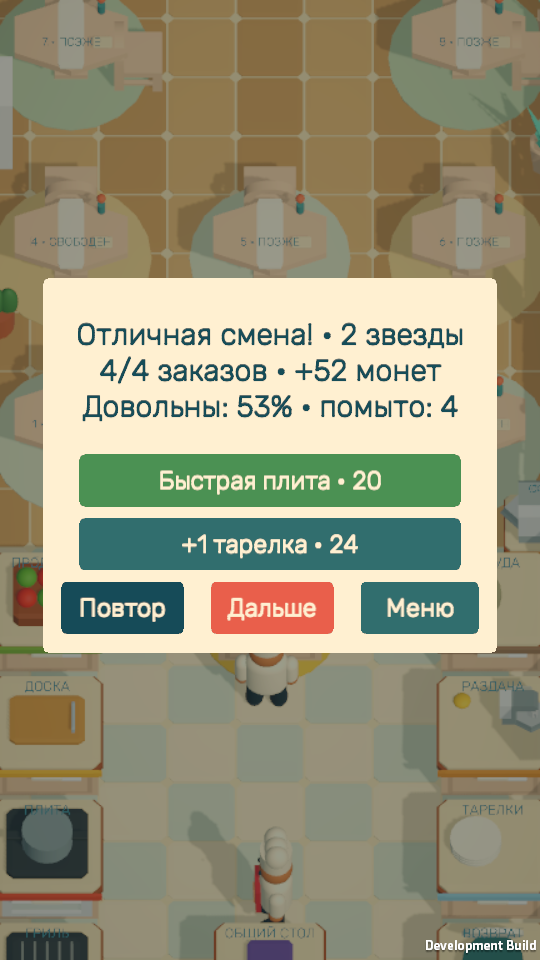

# KRCO — Kitchen Rush: Crazy Orders

*Working title. A cozy top-down 3D cooking game for iPhone and Mac with real online co-op for 2–4 players.*

**[English](#english) · [Русский](#русский)**

  
  
  
  
  

All images are unedited captures from the real game (Mac development build, portrait 9:16). No concept art, no AI-generated mock-ups.

---

## English

### The game

Run a small restaurant kitchen against the clock: pick up real ingredients, chop, cook, plate, serve each guest exactly what they ordered, collect the dirty dishes and wash them so the plates come back. Guests have patience, grouped orders of 1–3 dishes and their own personalities; story guests (Zhora, Shustry, Boris, Tamara, Lola) bring special requests.

- **Full cooking loop** — 8 recipes (soup, salad, eggs, burger, sandwich, pancakes, pasta, coffee) with real ingredient composition: a wrong ingredient spoils the dish, a wrong delivery upsets the guest.
- **Serving trays and dish stacks** — carry two plated dishes on a tray, stack up to three dirty plates per trip.
- **Career** — 60 story shifts in 6 chapters, plus **20 challenges** and **Free Play** days (3/5/8 minutes or endless, Quiet/Normal/Busy/Chaos waves).
- **Your own restaurant** — buy and place furniture, upgrade equipment; progress is stored in the cloud.
- **Virtual district** — opt-in public restaurants of real players (no GPS, no fake players): friends, invitations, read-only visits, privacy controls, reports and blocks.
- **Online co-op for 2–4 cooks** — every mode runs on a separate authoritative dedicated server, so the shift keeps going when any player (including the room creator) leaves, and players rejoin with their exact items.
- **Mobile-first controls** — dynamic virtual stick + one context button, two-finger input, left/right layout; WASD/arrows + E/Space on Mac.

### Engineering highlights

| Area | What it does |
|---|---|
| Server authority | Unity Netcode for GameObjects with a headless **Linux ARM64 IL2CPP dedicated server**. Clients send intents only; the server validates distance, ownership, request order and timing. Items, trays and dishes keep immutable IDs. |
| Crash recovery | The server writes an authenticated (HMAC), fsync'ed, atomically replaced checkpoint of the whole kitchen every change / 250 ms. After a `SIGKILL` a **new process** restores the match, fences the old one by incarnation, opens a new RPC epoch, freezes the shift timer while the same players reconnect, and rejects any pre-crash request. Verified end-to-end with real clients carrying a loaded tray. |
| Trusted rewards | The dedicated server verifies each player's Unity Authentication token (JWKS), then signs a per-account result statement (RSA-2048). The player's own account redeems it through Cloud Code, which pins the server key, recomputes coins/points under a fixed policy and stores the once-receipt in the same compare-and-set write as the credit — replays, retries and two devices never pay twice. |
| Weekly co-op ranking | Server-written leaderboard projection with weekly UTC reset; players cannot write scores directly (project access policy). Reads expose rank and score only. |
| Accounts & privacy | Anonymous/linked accounts, session token in the Keychain, account deletion with cross-bucket cleanup, opt-in public profile, RU/EN privacy policy drafts. |
| Operations | Private Ops console (MFA, roles, CSRF, audit log, encrypted backup/restore) with live server health and cost estimates; signed cloud moderation actions are being integrated. |
| QA | ~3,400 automated EditMode/PlayMode tests and a QA autopilot that plays all 60 + 20 authored shifts; scripted Mac/Linux multiplayer end-to-end runs. |

### Tech stack

Unity 6.3 LTS (URP, C#) · Netcode for GameObjects · Unity Gaming Services (Authentication, Cloud Code JS, Cloud Save, Leaderboards, Relay) · Linux ARM64 IL2CPP dedicated server in Docker · Python Ops console · Node.js test suite for the cloud contract.

### Status (October 2026)

| Gate | Status |
|---|---|
| Single player: career, challenges, free play | Implemented, automated QA green |
| Co-op 2/4 on a dedicated server, leave/rejoin | Verified locally (Mac + Linux VM) |
| Server crash recovery | Implemented, verified with real `SIGKILL` |
| Trusted co-op rewards & weekly ranking | Implemented, staging verification in progress |
| Social district | Verified on staging with two accounts |
| Public servers, TestFlight, App Store | **Not released** — pending hosting, legal and store decisions |

This repository is a **public showcase** (description, screenshots, architecture notes). The game source code and assets are kept in a private repository.

---

## Русский

### Игра

Уютная 3D-кухня с видом сверху для iPhone и Mac. Берите продукты, нарезайте, готовьте, раскладывайте по тарелкам, подавайте каждому гостю именно его заказ, собирайте грязную посуду и мойте её — иначе тарелки закончатся. У гостей есть терпение, заказы из 1–3 блюд и характер; сюжетные гости (Жора, Шустрый, Борис, Тамара, Лола) приносят особые задания.

- **Полный цикл готовки** — 8 рецептов с настоящим составом: лишний ингредиент портит блюдо, чужой заказ расстраивает гостя.
- **Подносы и стопки посуды** — два готовых блюда на подносе, до трёх грязных тарелок за ходку.
- **Карьера** — 60 сюжетных смен в 6 главах, **20 испытаний** и **свободная игра** (3/5/8 минут или без конца, тихие/обычные/шумные/хаотичные дни).
- **Свой ресторан** — мебель, улучшения, облачное сохранение.
- **Виртуальный район** — настоящие рестораны игроков только по согласию (без GPS и выдуманных игроков): друзья, приглашения, гостевые визиты, приватность, жалобы и блокировки.
- **Кооператив 2–4 повара** — во всех режимах через отдельный авторитетный выделенный сервер: смена продолжается, если кто-то вышел, и игроки возвращаются с теми же предметами.
- **Управление для телефона** — динамический стик и контекстная кнопка, два пальца одновременно; на Mac — WASD/стрелки и E/Space.

### Инженерия

- **Сервер — источник истины**: выделенный Linux ARM64 IL2CPP сервер проверяет расстояние, владение, порядок и время каждого действия.
- **Восстановление после падения сервера**: подписанный HMAC checkpoint всей кухни с `fsync` и атомарной заменой; после `SIGKILL` новый процесс восстанавливает матч, отсекает старый процесс, открывает новую эпоху запросов, замораживает таймер, пока те же игроки переподключаются, и отклоняет запросы до сбоя. Проверено с реальными клиентами и подносом с двумя блюдами.
- **Защищённые награды**: сервер проверяет токен Unity Authentication каждого игрока и подписывает результат (RSA-2048); облако пересчитывает монеты и очки по фиксированным правилам и записывает квитанцию в той же атомарной записи, что и начисление — повторы, сбои и два устройства не дают двойной награды.
- **Недельный рейтинг кооператива** пишет только сервер; клиенты видят только место и очки.
- **Аккаунты и приватность**: Keychain, удаление аккаунта, публичный профиль только по согласию.
- **Ops-консоль** с MFA, ролями, журналом аудита, шифрованным бэкапом; подписанная облачная модерация подключается.
- **QA**: около 3 400 автоматических тестов и автопилот, проходящий все 60 + 20 смен.

### Статус (октябрь 2026)

Игра в разработке. Одиночная игра и кооператив проверены локально, восстановление после падения сервера реализовано и проверено, защищённые награды проходят проверку на staging. Публичные серверы, TestFlight и App Store **ещё не запущены**.

Этот репозиторий — **публичная витрина** (описание, скриншоты, архитектура). Исходный код и ассеты игры хранятся в закрытом репозитории.

---

© 2026 KRCO project. All rights reserved. Screenshots and text may not be reused without permission. Third-party content used in the game is listed in [docs/CREDITS.md](docs/CREDITS.md).
