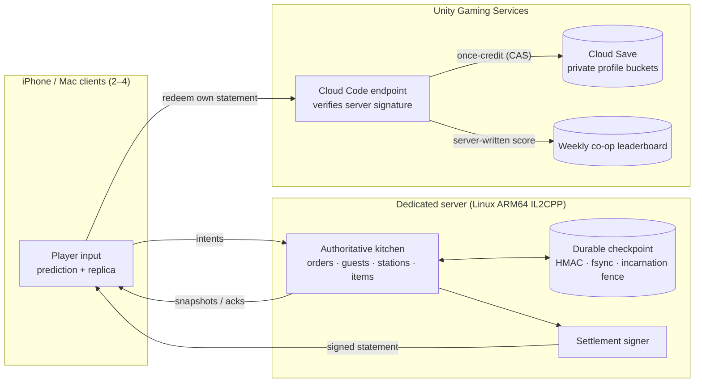

# Architecture overview

## Principles

- **The server decides.** Clients send intents (move, use station, choose recipe). Results, items, rewards and timers are computed by the authority and replicated.
- **Stable identity everywhere.** Every ingredient, dish, tray and plate has an immutable ID; replays and rejoins can be checked exactly.
- **Commit before acknowledge.** The authority's checkpoint is durable before the frame's acknowledgements are sent, so an acknowledged action survives a crash.
- **Fencing, not hope.** A restarted server advances a durable incarnation before admitting anyone; tickets and RPC epochs from before the crash stop working.
- **Rewards are recomputed, never copied.** The cloud trusts only a statement signed by the dedicated server, bound to the redeeming account, and applies a fixed policy with a once-receipt in the same atomic write.
- **Privacy by default.** Public restaurant listing is opt-in; leaderboards and directories never expose account IDs.
